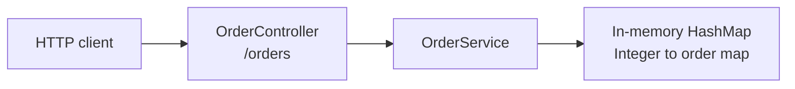

# Architecture

## Overview

SpringbootSample is a small Spring Boot web application that exposes an in-memory order-management API. The application bootstraps through `Application`, receives HTTP requests through `OrderController`, and implements validation, pricing, payment, refund, and cancellation behavior in `OrderService`.

The service is process-local: orders are stored in memory and disappear when the application stops. There is no database, repository layer, authentication, or external payment integration in the repository.

## Tech Stack

| Area | Observed technology |
|---|---|
| Language | Java 17 |
| Framework | Spring Boot 3.5.5 |
| Web stack | `spring-boot-starter-web` |
| Build | Maven; `pom.xml` and the Spring Boot Maven plugin |
| Packaging | Maven artifact `com.example:springboot-sample:0.0.1-SNAPSHOT` |
| Automation | GitHub Actions |

No test source files or additional runtime configuration files are present under `src/`.

## Repository Structure

```text
.github/
  skills/code-documentation/SKILL.md
  workflows/update-documentation.yml
docs/
  API.md
  ARCHITECTURE.md
  CHANGE_HISTORY.md
src/main/java/com/example/demo/
  Application.java
  controller/OrderController.java
  service/OrderService.java
pom.xml
README.md
```

## Architecture and Data Flow



- **Application** (`com.example.demo.Application`) is the Spring Boot entrypoint. Its `main` method runs `SpringApplication.run`.
- **OrderController** (`com.example.demo.controller.OrderController`) maps REST operations below `/orders` and delegates to `OrderService`.
- **OrderService** (`com.example.demo.service.OrderService`) owns a `HashMap<Integer, Map<String, Object>>`, assigns sequential IDs beginning at 1, and contains the order rules.
- **Order representation** uses `LinkedHashMap` for newly created orders and status responses. Orders are keyed by integer ID.

## Order Lifecycle

New orders start with `paymentStatus=PENDING` and `orderStatus=CREATED`.

- A normal payment changes those values to `PAID` and `CONFIRMED`.
- A payment with an amount greater than 10,000 is left in `REVIEW_REQUIRED` payment status and `PAYMENT_REVIEW` order status.
- Cancelling an unpaid order sets `orderStatus=CANCELLED`.
- Cancelling a paid order with an amount at or below 5,000 sets `paymentStatus=REFUNDED` and `orderStatus=CANCELLED`.
- Cancelling a paid order with an amount greater than 5,000 sets `orderStatus=REFUND_PENDING`; its response status is `REFUND_PENDING`.

Product prices are in `OrderService`: laptop 50,000, phone 20,000, keyboard 2,000, and mouse 1,000. Quantities greater than or equal to five receive a 10% discount.

## Entrypoints and Configuration

The application entrypoint is `com.example.demo.Application`. Spring's default web configuration is used; no application properties or environment-variable references are present.

The Maven parent supplies Spring Boot dependency and plugin conventions. The only application dependency declared in `pom.xml` is `spring-boot-starter-web`.

## Documentation Automation

`.github/workflows/update-documentation.yml` runs manually with `workflow_dispatch` or on pushes to `Stage` that do not modify `docs/**`. It checks out the triggering branch, installs Node.js 20 and `@github/copilot`, invokes the Copilot CLI with the code-documentation prompt, and commits changes under `docs/` with the `github-actions[bot]` identity. The workflow has `contents: write` and `copilot-requests: write` permissions and excludes bot actors to avoid self-triggered runs.
